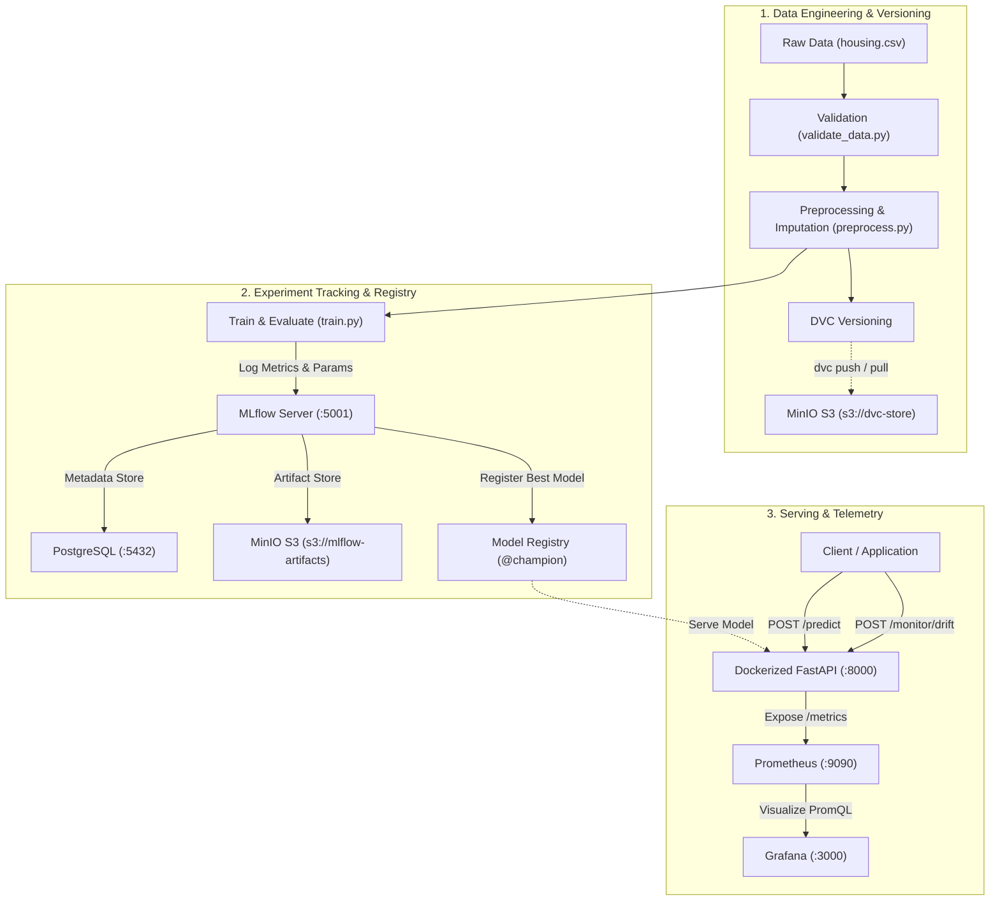

# 🚀 End-to-End MLOps Lab: House Price Prediction

A production-grade, hands-on, educational MLOps laboratory built strictly using **free and open-source technologies**.

This project implements the complete Machine Learning lifecycle: from reproducible synthetic data generation, validation, and DVC data versioning, through Scikit-learn model training, MLflow experiment tracking, automated champion model registration, containerized FastAPI inference with Prometheus instrumentation, and real-time Grafana observability.

---

## 🏗️ System Architecture



---

## 🛠️ Technology Stack

| Technology | Category | Purpose in this Project |
| :--- | :--- | :--- |
| **Python 3.11+** | Language | Core runtime for data processing, training, testing, and serving. |
| **Pandas & Scikit-learn** | ML Framework | Data manipulation, feature scaling, encoding, and regression modeling. |
| **DVC (Data Version Control)** | Data Versioning | Git-like version control for raw and processed datasets using content hashes. |
| **MinIO** | Object Storage | S3-compatible, self-hosted storage for DVC datasets and MLflow artifacts. |
| **PostgreSQL** | Relational DB | ACID backend metadata store for MLflow tracking experiments and runs. |
| **MLflow** | MLOps Platform | Experiment tracking, model signature enforcement, and Model Registry. |
| **FastAPI & Uvicorn** | Serving Framework | High-performance asynchronous REST API with strict Pydantic input validation. |
| **Docker & Docker Compose** | Containerization | Multi-service orchestration running all 6 infrastructure components locally. |
| **Prometheus** | Metrics Collection | Timeseries engine scraping API latency, throughput, errors, and price histograms. |
| **Grafana** | Visualization | Live interactive dashboards monitoring API health and ML output distributions. |
| **Pytest** | Automated Testing | Comprehensive 20-test automated validation suite. |
| **GitHub Actions** | CI Automation | Automated linting, pipeline execution, unit testing, and Docker builds. |

---

## 🌐 Local Service Endpoints & Default Credentials

All services run locally via Docker Compose. No external paid cloud accounts or APIs are required.

| Service | Host URL | Description | Default Credentials |
| :--- | :--- | :--- | :--- |
| **FastAPI Swagger UI** | [http://localhost:8000/docs](http://localhost:8000/docs) | Interactive API documentation | None |
| **FastAPI Health Probe** | [http://localhost:8000/health](http://localhost:8000/health) | Service health check | None |
| **FastAPI Metrics** | [http://localhost:8000/metrics](http://localhost:8000/metrics) | Prometheus metrics endpoint | None |
| **MLflow Tracking UI** | [http://localhost:5001](http://localhost:5001) | Experiments & Model Registry | None |
| **MinIO Web Console** | [http://localhost:9001](http://localhost:9001) | S3 Object Storage Browser | `minioadmin` / `minioadmin` |
| **MinIO S3 API** | `http://localhost:9000` | S3 REST Endpoint for DVC & Boto3 | `minioadmin` / `minioadmin` |
| **Prometheus Web UI** | [http://localhost:9090](http://localhost:9090) | PromQL Metrics & Target Health | None |
| **Grafana Dashboards** | [http://localhost:3000](http://localhost:3000) | Pre-provisioned MLOps Dashboard | `admin` / `admin` |
| **PostgreSQL Database** | `localhost:5432` | MLflow Backend Relational Store | `mlflow` / `mlflowpassword` |

> 💡 **macOS Note:** MLflow runs on port **`5001`** on the host machine to eliminate port conflicts with macOS AirPlay Receiver on port `5000`.

---

## ⚡ Quick Start: Running the System

### 1. Prerequisites
- [Docker & Docker Compose](https://docs.docker.com/get-docker/) installed and running.
- Python 3.11+ and Git installed.

### 2. Setup Virtual Environment
```bash
# Clone the repository and enter directory
cd demoProject

# Initialize virtual environment and install dependencies
python3 -m venv .venv
source .venv/bin/activate
pip install --upgrade pip
pip install -r requirements.txt

# Copy environment configuration
cp .env.example .env
```

### 3. Run the ML Pipeline Locally
```bash
# Runs data generation -> validation -> preprocessing -> model training & registry
make pipeline
```

### 4. Run the Automated Test Suite
```bash
make test
```
*Expected: 20 passed tests verifying data validation, preprocessing, regression models, API endpoints, 422 error tracking, and data drift detection.*

### 5. Start All Infrastructure Services
```bash
# Start MinIO, PostgreSQL, MLflow, FastAPI, Prometheus, and Grafana
docker compose up -d
```

Verify service status:
```bash
python scripts/verify_services.py
```

### 6. Test Model Predictions & Send Traffic
```bash
python scripts/test_prediction.py
```
This automated verification script:
1. Verifies `/health` returns status `healthy`.
2. Sends a single house prediction request to `POST /predict`.
3. Sends a batch scoring request to `POST /predict/batch`.
4. Sends an invalid input to verify Pydantic 422 handling and Prometheus error counters.
5. Tests the statistical data drift endpoint `POST /monitor/drift`.
6. Confirms Prometheus metrics are exported on `/metrics`.

---

## 📊 Live Monitoring in Grafana

1. Open **[http://localhost:3000](http://localhost:3000)** in your browser.
2. Log in with **`admin`** / **`admin`** (skip password change).
3. Navigate to **Dashboards** -> **MLOps Lab - House Price Service Dashboard**.
4. View live visual telemetry:
   - **Throughput Rate by Status** (Success vs. 422 Schema Errors)
   - **Latency Quantiles** ($p_{50}$, $p_{90}$, $p_{99}$)
   - **Predicted House Price Distribution Histogram**

---

## 📦 Data Version Control (DVC) with MinIO

Push and pull dataset versions directly to local MinIO:
```bash
# Export MinIO S3 credentials
export AWS_ACCESS_KEY_ID=minioadmin
export AWS_SECRET_ACCESS_KEY=minioadmin

# Push dataset version to MinIO bucket (s3://dvc-store)
dvc push

# Pull dataset version
dvc pull
```

---

## 🔄 Model Retraining Workflow

When data drift is detected or new training batches are collected:
1. Generate new raw data: `python src/data/generate_data.py`
2. Track new data version: `dvc add data/raw/housing.csv && git commit -m "chore: update dataset" && dvc push`
3. Execute pipeline: `make pipeline`
4. The training script automatically compares Linear Regression vs Random Forest on unseen test data.
5. If the new candidate model achieves a lower Test RMSE than the current champion, it is automatically registered as a new version in MLflow Model Registry and assigned the `@champion` alias and `Production` stage.
6. Restart the serving container: `docker compose restart api`.

---

## 📚 In-Depth Learning Documentation

Detailed technical breakdowns for every component:
- [System Architecture Blueprint](docs/architecture.md)
- [Data Versioning with DVC](docs/data-versioning.md)
- [MinIO S3 Setup & Architecture](docs/minio-setup.md)
- [MLflow Server & Metadata Storage](docs/mlflow-setup.md)
- [Model Training & Evaluation](docs/model-training.md)
- [MLflow Model Registry & Promotion](docs/model-registry.md)
- [FastAPI Deployment & Docker](docs/deployment.md)
- [Infrastructure vs. ML Monitoring](docs/monitoring.md)
- [Continuous Integration (CI) Automation](docs/ci-cd.md)
- [Troubleshooting & Operations Guide](docs/troubleshooting.md)

