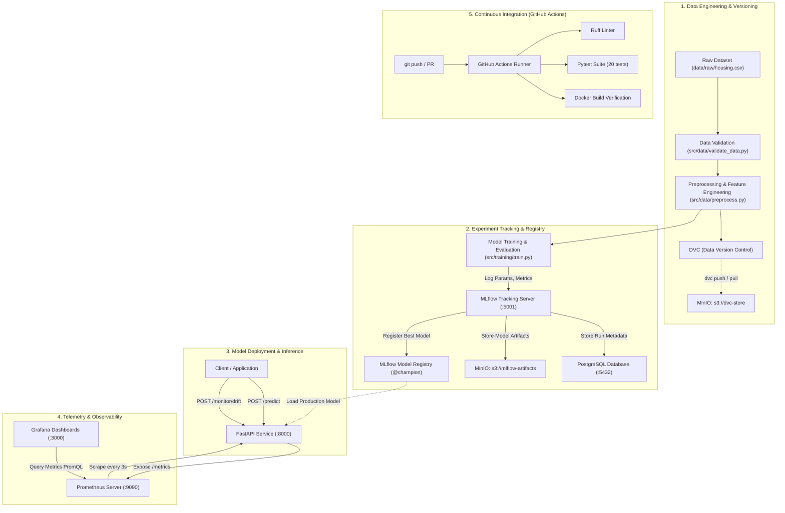
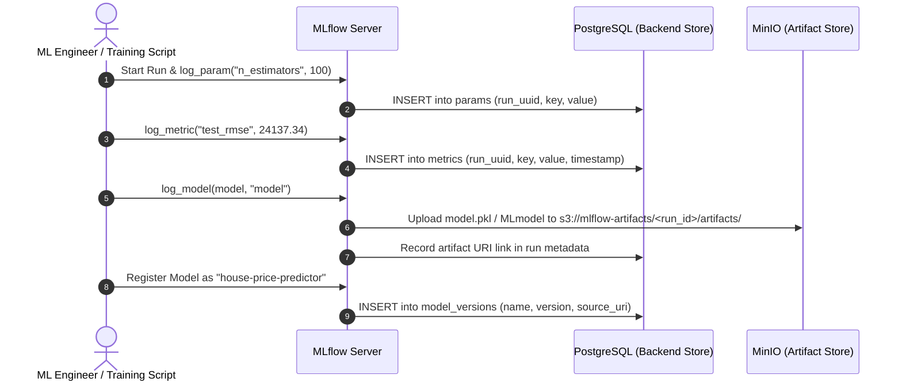

# System Architecture & Technical Blueprint

This document details the complete end-to-end architecture of the **MLOps Lab**, mapping every component across data engineering, model training, experiment tracking, model registry, containerized serving, metrics monitoring, and automated CI pipelines.

---

## 1. High-Level System Architecture

The following Mermaid diagram visualizes the flow of data, artifacts, metadata, and runtime metrics across all local microservices.

---

## 2. Component Directory & Network Topology

| Service | Technology | Port (Host / Container) | Primary Role |
| :--- | :--- | :--- | :--- |
| **PostgreSQL** | Postgres 16 Alpine | `5432:5432` | Stores MLflow experiment metadata, runs, metrics, parameters, and registry state. |
| **MinIO** | MinIO RELEASE.2024 | `9000:9000` (API) `9001:9001` (Web) | S3-compatible object storage for DVC tracked datasets and MLflow model artifacts. |
| **MLflow Server** | Python 3.11 + MLflow | `5001:5000` | Experiment tracking server, model lineage tracker, and model registry coordinator. |
| **FastAPI API** | Python 3.11 + Uvicorn | `8000:8000` | Production model REST serving, schema validation with Pydantic, and Prometheus exporter. |
| **Prometheus** | Prometheus v2.53 | `9090:9090` | Timeseries database collecting API throughput, latency, error rate, and prediction distributions. |
| **Grafana** | Grafana 11.1 | `3000:3000` | Live interactive visual dashboard displaying system health and ML monitoring panels. |

---

## 3. Storage Separation Design Principle

A frequent point of confusion in MLOps architectures is the difference between **Backend Metadata Storage** and **Artifact Storage**:

- **PostgreSQL (Backend Store):** Only stores tabular, structured relational data (run IDs, execution timestamps, metric histories, hyperparameter values, tags, model version numbers).
- **MinIO (Artifact Store):** Only stores binary files and large blobs (pickled models, preprocessor pipelines, evaluation figures, DVC raw/processed datasets).

---

## 4. End-to-End Execution Sequence

1. **Synthetic Data Generation:** `src/data/generate_data.py` creates 2,000 realistic residential transactions saved at `data/raw/housing.csv`.
2. **Schema & Integrity Validation:** `src/data/validate_data.py` inspects required columns, ranges, and categorical labels.
3. **Feature Preprocessing:** `src/data/preprocess.py` creates a scikit-learn `ColumnTransformer` with median imputation, one-hot encoding, and standard scaling. Fits solely on the training split to eliminate data leakage.
4. **Data Versioning:** DVC hashes the raw data into `.dvc/cache` and pushes to `s3://dvc-store`.
5. **Model Training & Comparison:** `src/training/train.py` fits Linear Regression and Random Forest Regressor models, evaluates test RMSE, MSE, MAE, and R², and pushes runs to MLflow.
6. **Model Promotion:** The model with the lowest test RMSE is registered as version 1 in MLflow Model Registry and assigned the `@champion` alias and `Production` stage.
7. **Serving:** FastAPI initializes, loads the champion model, and serves predictions via `POST /predict`.
8. **Observability:** Prometheus scrapes `http://api:8000/metrics` every 3 seconds; Grafana provides real-time visualization of latency percentiles and predicted price distributions.

