# Continuous Integration & Local Continuous Delivery (CI/CD) Architecture

## 1. Can GitHub Actions Push Directly to Local MinIO (`localhost:9000`)?

**Short answer:** Not from GitHub's cloud runners (`ubuntu-latest`), **but YES from a free GitHub Actions Self-Hosted Runner on your Mac.**

- **GitHub-Hosted Runner (`ubuntu-latest`):** Runs inside GitHub's cloud infrastructure. Inside that runner, `localhost:9000` refers to the runner itself, not your laptop behind your local network/NAT. Therefore, `ci.yml` spins up an **ephemeral** `pgsty/silo:latest` container inside the runner to verify `dvc push` and `scripts/push_model_minio.py` end-to-end without touching your local disk.
- **Self-Hosted Runner on Your Mac (`self-hosted`):** Installs the lightweight official open-source GitHub Actions runner agent on your Mac. GitHub still hosts the UI, logs, and triggers (`push` / `workflow_dispatch`), while execution happens directly on your machine—so workflows have native access to your real local MinIO (`http://localhost:9000`), local MLflow (`http://localhost:5001`), Docker Compose stack, and Kind Kubernetes cluster (`kind-mlops-lab`).

*(Avoid exposing `localhost:9000` to the public internet just for CI—keeping a self-hosted runner on your Mac is safer, faster, and completely free.)*

---

## 2. Two-Workflow Automation Architecture

| Workflow File | Runner | Trigger | What It Automates |
| :--- | :--- | :--- | :--- |
| [`.github/workflows/ci.yml`](../.github/workflows/ci.yml) | `ubuntu-latest` (GitHub Cloud) | `push` (`main`, `master`, `v2`, `feat/*`, `fix/*`), `pull_request`, `workflow_dispatch` | Ruff lint/format, ephemeral MinIO startup, data generation/validation/preprocessing, training, `dvc push`, `scripts/push_model_minio.py`, 20 Pytest tests, `kubectl kustomize k8s/`, Docker image build (`push: false`) |
| [`.github/workflows/local-cd.yml`](../.github/workflows/local-cd.yml) | `self-hosted` (Your Mac) | `workflow_dispatch` (and optional `push` once runner is online) | Full pipeline on your Mac: lint, DVC add/repro (`--force`), `dvc push` to local MinIO, `push_model_minio.py` to `s3://mlflow-artifacts/model/`, Pytest, Docker Compose reload, Kind `kind-mlops-lab` image load + rollout restart, live verification scripts |

```mermaid
flowchart TD
    Push["git push / workflow_dispatch"]

    subgraph CloudCI["1. Cloud CI (.github/workflows/ci.yml on ubuntu-latest)"]
        C1["Ruff lint & format check"]
        C2["Start ephemeral pgsty/silo MinIO + create buckets"]
        C3["generate -> validate -> preprocess -> train"]
        C4["dvc add/push + scripts/push_model_minio.py"]
        C5["pytest -v + kubectl kustomize k8s/ + Docker Buildx"]
        C1 --> C2 --> C3 --> C4 --> C5
    end

    subgraph LocalCD["2. Local CD (.github/workflows/local-cd.yml on Mac self-hosted)"]
        L1["Sync .venv & Ruff check"]
        L2["Verify/start local MinIO (localhost:9000) & MLflow (localhost:5001)"]
        L3["generate -> dvc add -> dvc repro --force"]
        L4["dvc push (local s3://dvc-store) + push_model_minio.py (local s3://mlflow-artifacts/model/)"]
        L5["pytest -v"]
        L6["Reload Docker Compose & Kind (kind load + rollout restart)"]
        L7["verify_services.py & verify_k8s.py"]
        L1 --> L2 --> L3 --> L4 --> L5 --> L6 --> L7
    end

    Push --> CloudCI
    Push --> LocalCD
```



---

## 3. Setting Up the Free Self-Hosted Runner on Your Mac

Automatic `push` triggers in [`.github/workflows/local-cd.yml`](../.github/workflows/local-cd.yml) start commented out so pushes won't queue indefinitely before your runner is registered. To enable full local automation:

1. Open your GitHub repository in the browser:
   **Settings -> Actions -> Runners -> New self-hosted runner**
2. Select **macOS** and your chip architecture (**ARM64** for Apple Silicon M1/M2/M3/M4, or **x64** for Intel).
3. Run the Download & Configure commands GitHub displays in a separate folder (for example `~/actions-runner`, **not** inside your git repo):
   ```bash
   mkdir -p ~/actions-runner && cd ~/actions-runner
   # Paste the curl download + tar extraction commands shown in GitHub UI
   # Paste ./config.sh --url https://github.com/<owner>/<repo> --token <TOKEN>
   ```
4. Start the runner in the foreground (or install it as a background macOS service):
   ```bash
   # Foreground (stops when terminal closes):
   ./run.sh

   # OR background service on macOS:
   ./svc.sh install
   ./svc.sh start
   ```
5. Verify on GitHub under **Settings -> Actions -> Runners** that your Mac shows as **Idle** (green).
6. Trigger **Local CD - Train, Push to Local MinIO & Reload Runtime** manually from the GitHub **Actions** tab (`Run workflow`), or uncomment the `push:` block in `.github/workflows/local-cd.yml` so every push to `main` or `v2` automatically trains and pushes to your local MinIO, Compose stack, and Kind cluster.

---

## 4. Detailed Cloud CI Breakdown (`.github/workflows/ci.yml`)

### Job 1: `code-quality-and-tests` (`ubuntu-latest`)
1. **Ruff Lint & Format:** Runs `ruff check src/ api/ tests/ scripts/` and `ruff format --check src/ api/ tests/ scripts/`.
2. **Ephemeral MinIO Container:** Starts `pgsty/silo:latest server /data` on port `9000`, polls `/minio/health/live`, and ensures `dvc-store` and `mlflow-artifacts` buckets exist.
3. **End-to-End Pipeline & Storage Verification:** Runs `generate_data.py`, `validate_data.py`, `preprocess.py`, `train.py`, `dvc add data/raw/housing.csv`, `dvc push`, and `scripts/push_model_minio.py`, then asserts objects exist in `s3://dvc-store` and `s3://mlflow-artifacts/model/`.
4. **Pytest Suite:** Executes `pytest -v --durations=10` (20 tests covering validation, preprocessing, metrics, API endpoints, and drift detection).

### Job 2: `validate-k8s-manifests` (`ubuntu-latest`)
- Renders `kubectl kustomize k8s/` cleanly to catch YAML syntax or Kustomize resource reference issues on every push.

### Job 3: `build-docker-image` (`ubuntu-latest`)
- Downloads the trained model artifact from Job 1 and builds `./Dockerfile` via Docker Buildx (`push: false`).

---

## 5. How to Run Equivalent Checks Locally via `Makefile`

```bash
# 1. Format and lint check
make lint

# 2. Run data pipeline & training
make pipeline

# 3. Push DVC data & trained models to local MinIO
make dvc-push
make push-model

# 4. Run Pytest suite
make test

# 5. Build Docker container & verify Kind deployment
make docker-build
make k8s-verify
```
