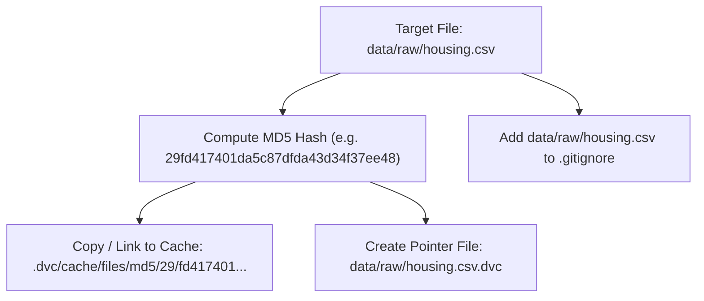

# Data Version Control (DVC) Guide

## 1. What Problem Does DVC Solve?

Git was designed for source code: lightweight text files that can be easily diffed and merged line by line. When developers commit machine learning datasets, model weights, or large binary files directly into Git:
- The `.git` folder grows indefinitely because Git stores complete file snapshots upon modifications.
- Repositories become slow to clone, push, and fetch.
- GitHub and GitLab reject commits containing files larger than 50MB to 100MB.

**DVC (Data Version Control)** solves this problem by decoupling large data storage from metadata tracking:
- Large datasets and model weights are kept in an external storage system (e.g. MinIO, Amazon S3, Google Cloud Storage).
- Small human-readable pointer files (`.dvc` files and `dvc.yaml`) containing cryptographic content hashes are committed to Git.
- Anyone cloning the Git repository can recreate the exact data version with a single command: `dvc pull`.

---

## 2. Why Are We Using DVC in this Lab?

1. **Reproducibility:** Machine learning results are a function of `Code + Data + Hyperparameters`. Versioning code alone is insufficient if the training data changes underneath.
2. **Seamless S3 / MinIO Integration:** DVC natively connects to local MinIO object storage without requiring paid cloud providers.
3. **Pipeline Orchestration:** DVC pipelines (`dvc.yaml`) define directed acyclic graphs (DAGs) connecting data validation, preprocessing, and training stages, automatically executing only the steps whose inputs or dependencies changed.

---

## 3. How DVC Works Internally

### How DVC Identifies Changed Files

When you execute `dvc add data/raw/housing.csv`, DVC executes the following sequence:



1. **Hash Computation:** DVC reads the target file and calculates its MD5 checksum.
2. **Content-Addressable Storage (CAS):** DVC stores the file in its internal cache directory (`.dvc/cache/files/md5/`) structured by the first 2 characters of the hash as a subfolder, followed by the remaining 30 characters (similar to Git's object database).
3. **State Database Optimization:** DVC maintains a local SQLite database (`.dvc/tmp/rw/state`) recording the file's modification timestamp (`mtime`), file size, and inode number. When you run `dvc status`, DVC first compares the file's current filesystem timestamp and size against this index. If both match, DVC skips recalculating the MD5 checksum, enabling near-instant status checks even on multi-gigabyte files.
4. **Metadata Pointer (`.dvc`):** DVC writes a tiny YAML file alongside the original data:
   ```yaml
   outs:
   - md5: 29fd417401da5c87dfda43d34f37ee48
     size: 68261
     hash: md5
     path: housing.csv
   ```
5. **Git Independence:** DVC adds the actual file (`housing.csv`) to `.gitignore` so Git only tracks `housing.csv.dvc`.

### How DVC Determines What Needs Uploading (`dvc push`)

When you run `dvc push`:
1. DVC inspects the pointer files in your repository to determine which MD5 hashes are required.
2. It queries the configured remote storage (`s3://dvc-store`) to list hashes already present in the remote bucket.
3. It performs a set difference: `Missing Hashes = Required Hashes - Remote Hashes`.
4. Only the missing objects are transferred over HTTP/S3 to MinIO. If an object with that exact hash already exists in MinIO, it is never re-uploaded.

---

## 4. Key Configuration Files

| File | Purpose | Committed to Git? |
| :--- | :--- | :--- |
| `.dvc/config` | Global and remote storage configuration (remote URLs, endpoints). | Yes |
| `.dvc/config.local` | Local user secrets (e.g. access keys). | No (in `.gitignore`) |
| `data/raw/housing.csv.dvc` | Tracking pointer containing dataset MD5 and size. | Yes |
| `dvc.yaml` | Declarative definition of data validation, preprocessing, and training stages. | Yes |
| `dvc.lock` | Exact hash lock of pipeline dependencies and generated outputs. | Yes |

---

## 5. Daily Real-World Commands

```bash
# 1. Track a new or modified dataset
dvc add data/raw/housing.csv

# 2. Check synchronization status with remote MinIO
dvc status -r minio-remote

# 3. Push local dataset cache to MinIO
dvc push

# 4. Pull dataset version corresponding to the current Git commit
dvc pull

# 5. Inspect difference between two versions
dvc diff

# 6. Execute reproducible pipeline defined in dvc.yaml
dvc repro
```

---

## 6. Troubleshooting Common DVC Errors

### Error: `ERROR: unexpected error - unable to open database file`
- **Cause:** SQLite cache lock conflict or permission restriction in sandboxed/restricted environments.
- **Solution:** Verify write permissions on `.dvc/tmp/` and execute with proper user permissions.

### Error: `Could not connect to the endpoint URL: http://localhost:9000`
- **Cause:** MinIO container is not running or port 9000 is blocked.
- **Solution:** Verify MinIO is healthy via `docker compose ps` and `curl -I http://localhost:9000/minio/health/live`.

### Error: `Bucket does not exist: dvc-store`
- **Cause:** MinIO started but initialization script hasn't run.
- **Solution:** Run `docker compose up minio-init` or create the bucket manually via MinIO Console at `http://localhost:9001`.

