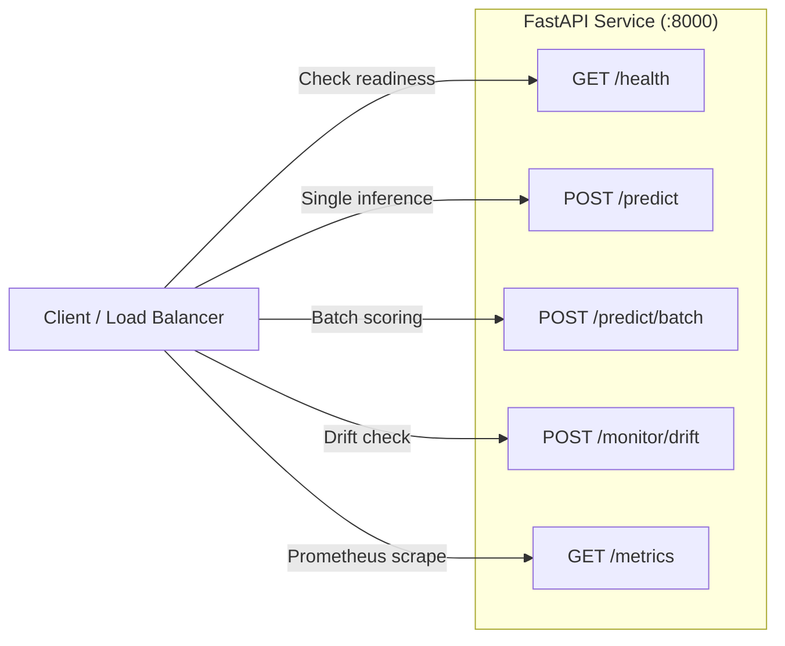
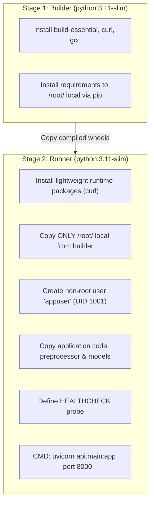

# Model Deployment & Containerization Architecture

## 1. What Problem Does Containerized Model Serving Solve?

When deploying machine learning models into production, teams frequently face the "works on my machine" syndrome:
- Missing system libraries (e.g. C/C++ compilation headers, OpenBLAS, libgomp).
- Subtly different Python dependency versions causing serialization/deserialization crashes.
- Difficult scaling across multiple server instances or cloud clusters.

**Docker Containerization** packages the operating system libraries, Python runtime, pinned dependencies, preprocessor, and serving application into a single, immutable, standalone image that runs identically on macOS, Linux, and cloud environments.

---

## 2. Why FastAPI?

1. **High Performance & Concurrency:** Powered by Starlette and Uvicorn, FastAPI is one of the fastest Python web frameworks, capable of handling thousands of requests per second asynchronously.
2. **Strict Schema Validation:** Powered by Pydantic V2, all incoming HTTP payloads are validated at runtime for field presence, types, and boundaries before reaching the ML model.
3. **Interactive Documentation:** Automatically generates interactive Swagger UI documentation at `/docs` and ReDoc at `/redoc` with zero manual effort.
4. **First-Class Metrics Instrumentation:** Exposes Prometheus metrics (`/metrics`) natively for telemetry and monitoring.

---

## 3. API Endpoints Reference



### 1. `GET /health`
- **Purpose:** Health check probe for Docker Compose, Kubernetes, and load balancers.
- **Sample Output:**
  ```json
  {
    "status": "healthy",
    "model_loaded": true,
    "model_name": "house-price-predictor",
    "model_version": "1.0.0-local",
    "uptime_seconds": 34.2
  }
  ```

### 2. `POST /predict`
- **Purpose:** Score features for a single property.
- **Request Body:**
  ```json
  {
    "area": 2200,
    "bedrooms": 3,
    "bathrooms": 2.5,
    "location": "suburban",
    "age": 12,
    "garage": 2
  }
  ```
- **Response:**
  ```json
  {
    "predicted_price": 542300.0,
    "currency": "USD",
    "model_name": "house-price-predictor",
    "model_version": "1.0.0-local",
    "features_received": {
      "area": 2200,
      "bedrooms": 3,
      "bathrooms": 2.5,
      "location": "suburban",
      "age": 12,
      "garage": 2
    }
  }
  ```

### 3. `POST /predict/batch`
- **Purpose:** Score multiple properties in a single round-trip HTTP request.
- **Request Body:**
  ```json
  {
    "houses": [
      { "area": 1500, "bedrooms": 2, "bathrooms": 1.5, "location": "urban", "age": 20, "garage": 1 },
      { "area": 3500, "bedrooms": 4, "bathrooms": 3.5, "location": "rural", "age": 5, "garage": 2 }
    ]
  }
  ```

### 4. `POST /monitor/drift`
- **Purpose:** Evaluates feature distribution drift of an incoming batch against the reference baseline training dataset using two-sample Kolmogorov-Smirnov and Chi-Square tests.

### 5. `GET /metrics`
- **Purpose:** Prometheus scraping endpoint exposing inference counters, latency histograms, and output price distribution.

---

## 4. Multi-Stage Dockerfile Architecture

Our `Dockerfile` implements a **multi-stage build** pattern:



**Benefits:**
- **Minimal Image Size:** Build tools (gcc, make, headers) are discarded and never shipped into production.
- **Enhanced Security:** Container runs as non-root user `appuser` (UID 1001).
- **Embedded Healthcheck:** Automatically restarts container if the application stops responding to `/health`.

