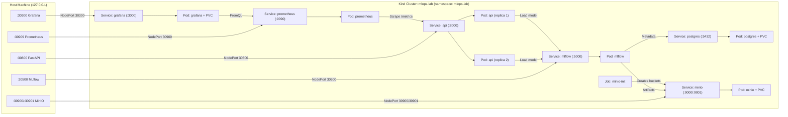

# Kubernetes Local Cluster Setup with Kind (Kubernetes in Docker)

## 1. What Problem Does Kubernetes Solve?

Docker Compose is great for single-host development, but production ML platforms require:
- **Self-healing workloads:** Automatically restarting failed prediction containers and rescheduling pods across nodes.
- **Horizontal scaling & load balancing:** Running multiple FastAPI replicas behind a single Service VIP.
- **Declarative infrastructure & separation of concerns:** Managing configuration (`ConfigMap`), credentials (`Secret`), persistent storage (`PersistentVolumeClaim`), and initialization jobs (`Job`) consistently.

**Kind (Kubernetes in Docker)** runs real multi-node Kubernetes clusters (`control-plane` + `worker` nodes) inside Docker containers locally—no paid managed Kubernetes (EKS/GKE/AKS) required.

---

## 2. Why Kind in This Lab?

1. **Zero Cloud Cost:** Tests real Kubernetes manifests (`Deployment`, `Service`, `PVC`, `Job`, `ConfigMap`, `Secret`, `Kustomization`) entirely on your laptop.
2. **Coexists with Docker Compose:** Uses `127.0.0.1:30xxx` NodePort mappings so Docker Compose (`3000`, `5001`, `8000`, `9000`, `9090`) and Kind Kubernetes can run side-by-side without port collisions.
3. **Production-Parity Patterns:** Includes readiness/liveness probes, init containers, resource requests/limits, multi-node scheduling, and Kustomize packaging.

---

## 3. Architecture & Pod Communication



---

## 4. Important Manifests & Scripts

- [`k8s/kind-config.yaml`](../k8s/kind-config.yaml): Multi-node Kind topology (`control-plane` + `worker`) and `extraPortMappings` (`30300`, `30500`, `30800`, `30900`, `30901`, `30909`).
- [`k8s/kustomization.yaml`](../k8s/kustomization.yaml): Kustomize manifest list deployed into namespace `mlops-lab`.
- [`k8s/configmap.yaml`](../k8s/configmap.yaml) & [`k8s/secret.example.yaml`](../k8s/secret.example.yaml): Non-secret config and secret template (populated dynamically from `.env` by the deploy script).
- [`k8s/postgres.yaml`](../k8s/postgres.yaml), [`k8s/minio.yaml`](../k8s/minio.yaml), [`k8s/mlflow.yaml`](../k8s/mlflow.yaml), [`k8s/fastapi.yaml`](../k8s/fastapi.yaml), [`k8s/prometheus.yaml`](../k8s/prometheus.yaml), [`k8s/grafana.yaml`](../k8s/grafana.yaml): Workload Deployments, PVCs, Services, initContainers, and `minio-init` Job.
- [`scripts/k8s_deploy.sh`](../scripts/k8s_deploy.sh): Idempotent cluster creation, `kind load docker-image` for custom images, Secret/ConfigMap injection, Kustomize apply, and rollout wait.
- [`scripts/verify_k8s.py`](../scripts/verify_k8s.py): Automated health check, live `/predict` smoke test, and Prometheus target verification against the Kind cluster.

---

## 5. Common Workflows & Commands

```bash
# 1. Start the Kind cluster & deploy all 7 services
make k8s-up
# (or: bash scripts/k8s_deploy.sh)

# 2. Check nodes, pods, services, and PVCs
make k8s-status
# (or: kubectl get pods,svc,pvc -n mlops-lab -o wide)

# 3. Verify all NodePorts, live prediction, and Prometheus scraping
make k8s-verify
# (or: .venv/bin/python scripts/verify_k8s.py)

# 4. Stream logs or scale FastAPI replicas
kubectl logs -f deployment/api -n mlops-lab
kubectl scale deployment/api --replicas=3 -n mlops-lab

# 5. Tear down the Kind cluster
make k8s-down
# (or: kind delete cluster --name mlops-lab)
```

---

## 6. Service Endpoints (Kind)

| Service | Host URL | Credentials |
| :--- | :--- | :--- |
| **FastAPI Swagger UI** | http://localhost:30800/docs | None |
| **MLflow UI** | http://localhost:30500 | None |
| **MinIO Console** | http://localhost:30901 | `minioadmin` / `minioadmin` |
| **Prometheus UI** | http://localhost:30909 | None |
| **Grafana Dashboard** | http://localhost:30300 | `admin` / `admin` |

---

## 7. Troubleshooting Common Kind Issues

- **`ErrImageNeverPull` or `ImagePullBackOff` for `mlops-*` images:** Custom images are local only—reload them with `kind load docker-image mlops-fastapi-service:1.0.0 mlops-mlflow-server:1.0.0 --name mlops-lab`.
- **Docker Desktop multi-arch digest error on `kind load`:** Public images (`postgres`, `pgsty/silo`, `prometheus`, `grafana`) should be pulled by Kind's `containerd` directly instead of `kind load` (`scripts/k8s_deploy.sh` handles this automatically).
- **MLflow 403 Forbidden on Kubernetes probes:** `mlflow.yaml` sets `--allowed-hosts "*"` and uses an `exec` (`curl http://localhost:5000/`) probe so kubelet Pod-IP health checks pass.
- **Postgres PVC `initdb` directory not empty error:** `postgres.yaml` sets `PGDATA=/var/lib/postgresql/data/pgdata` so initialization succeeds even when the volume contains `lost+found`.

---

## 8. GitOps Continuous Delivery with Argo CD

Argo CD watches the `k8s/` directory in `https://github.com/mdrakibislam68/mlopsdemo2.git` (`v2` branch) via [`k8s/argocd/application.yaml`](../k8s/argocd/application.yaml) with `selfHeal: true` and `prune: false` (so secrets and ConfigMaps created by `scripts/k8s_deploy.sh` are preserved).

```bash
# 1. Make sure Kind cluster & base Secrets/ConfigMaps are running
make k8s-up

# 2. Install Argo CD into the 'argocd' namespace and apply the Application
make argocd-up

# 3. Check pod and Application sync status
make argocd-status

# 4. Print admin password and open the Argo CD UI (https://localhost:8081)
make argocd-password
make argocd-ui
```

---

## 9. KServe Model Serving (Standard / RawDeployment Mode)

KServe (`v0.21.0`) serves `s3://mlflow-artifacts/kserve-model/model.joblib` directly from Kind MinIO using `InferenceService` [`k8s/kserve/inference-service.yaml`](../k8s/kserve/inference-service.yaml), without requiring Knative or Istio:

```bash
# 1. Install cert-manager + KServe and deploy InferenceService 'house-price-kserve'
make kserve-up

# 2. Check InferenceService and predictor pod status
make kserve-status

# 3. Port-forward KServe predictor to http://localhost:8082
make kserve-forward

# 4. Port-forward Kubeflow KServe Models Web UI to http://localhost:8085
make kserve-ui
```

---

## 10. Standalone Kubeflow Pipelines (KFP Lite)

Standalone Kubeflow Pipelines gives you the official Kubeflow DAG UI, run experiments, artifact tracking, and scheduled recurring workflow orchestration without the overhead of the entire 60+ pod Kubeflow suite:

```bash
# 1. Install Kubeflow Pipelines on Kind cluster
make kfp-up

# 2. Check Kubeflow Pipelines pods and status
make kfp-status

# 3. Port-forward official Kubeflow Pipelines Dashboard
make kfp-ui
# Access in browser at: http://localhost:8080
```

