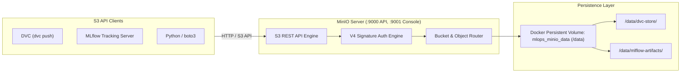

# MinIO S3 Object Storage Setup & Architecture

## 1. What Problem Does MinIO Solve?

In enterprise machine learning environments, teams use cloud object stores (like AWS S3, Google Cloud Storage, or Azure Blob) to store petabytes of training data, model binaries, and checkpoint files.

However, developing and learning with cloud storage introduces major drawbacks:
- Requires paid cloud accounts and credit card credentials.
- Introduces egress bandwidth fees and unexpected cloud billing spikes.
- Requires internet connectivity, slowing down local experimentation.

**MinIO** solves this by providing a 100% open-source, high-performance, S3-compatible object storage server that runs anywhere: locally on a laptop inside Docker, in bare-metal on-premise clusters, or in Kubernetes. Software tools like DVC, MLflow, and boto3 interact with MinIO using the exact same standard AWS S3 API commands (`s3://bucket-name`).

---

## 2. Why Are We Using MinIO in this Lab?

1. **Local Cloud Emulation:** We emulate a real enterprise AWS S3 environment locally without paying a single cent to AWS.
2. **Unified Storage Backend:** Both **DVC** (data versions) and **MLflow** (model artifacts) point to MinIO as their S3 storage target.
3. **Reproducibility with Docker Compose:** Starts automatically alongside PostgreSQL, MLflow, and FastAPI with persistent Docker volumes.

---

## 3. How MinIO Works Internally

MinIO runs as a single lightweight Go binary that handles AWS S3 REST API requests (V4 signature authorization, bucket operations, multipart uploads):



### Communication Flow with MLflow and DVC:
- **MLflow Tracking Server:** When a training run saves a model (`mlflow.sklearn.log_model`), the MLflow server streams the model binary over HTTP to `http://minio:9000/mlflow-artifacts/<run_id>/artifacts/model/model.pkl`. It records the URI `s3://mlflow-artifacts/<run_id>/artifacts/model` in PostgreSQL.
- **FastAPI Model Loader:** When FastAPI queries MLflow for model version `@champion`, MLflow returns the S3 artifact path. FastAPI uses boto3 to download the model artifact directly from MinIO and loads it into memory.
- **DVC Remote:** DVC hashes `data/raw/housing.csv` and uploads the file to `http://localhost:9000/dvc-store/files/md5/<hash>`.

---

## 4. Key Configuration Parameters

All MinIO parameters are configured via environment variables in `.env`:

```bash
# MinIO Root Credentials (acts as AWS root access key & secret)
MINIO_ROOT_USER=minioadmin
MINIO_ROOT_PASSWORD=minioadmin

# Ports
MINIO_API_PORT=9000        # S3 API protocol port
MINIO_CONSOLE_PORT=9001    # Web UI administration console port

# Buckets
MINIO_DVC_BUCKET=dvc-store
MINIO_MLFLOW_BUCKET=mlflow-artifacts

# AWS SDK configuration for boto3, MLflow, and DVC
AWS_ACCESS_KEY_ID=minioadmin
AWS_SECRET_ACCESS_KEY=minioadmin
AWS_DEFAULT_REGION=us-east-1
MLFLOW_S3_ENDPOINT_URL=http://minio:9000
```

---

## 5. Automated Bucket Initialization (`minio-init`)

Object stores require buckets to exist before applications can upload files. Rather than requiring users to manually log in to the web console and click "Create Bucket", our system includes a lightweight initialization service (`minio-init`) in `docker-compose.yml`:

```bash
#!/bin/sh
until /usr/bin/mc alias set localminio http://minio:9000 "${MINIO_ROOT_USER}" "${MINIO_ROOT_PASSWORD}"; do
  sleep 2
done
/usr/bin/mc mb --ignore-existing localminio/dvc-store
/usr/bin/mc mb --ignore-existing localminio/mlflow-artifacts
```

---

## 6. Real-World MinIO Client (`mc`) Commands

```bash
# Configure alias for MinIO server
mc alias set localminio http://localhost:9000 minioadmin minioadmin

# List buckets
mc ls localminio

# List contents of MLflow artifacts bucket
mc ls localminio/mlflow-artifacts --recursive

# Inspect storage usage
mc du localminio/dvc-store

# Download an artifact directly
mc cp localminio/mlflow-artifacts/<run_id>/artifacts/model/model.pkl ./downloaded_model.pkl
```

---

## 7. Troubleshooting Common MinIO Errors

### Error: `SignatureDoesNotMatch: The request signature we calculated does not match`
- **Cause:** Incorrect `AWS_ACCESS_KEY_ID` or `AWS_SECRET_ACCESS_KEY` provided to the client.
- **Solution:** Verify that client environment variables match `MINIO_ROOT_USER` and `MINIO_ROOT_PASSWORD` in `.env`.

### Error: `NoSuchBucket: The specified bucket does not exist`
- **Cause:** Application tried uploading to `dvc-store` before the bucket was created.
- **Solution:** Check status of `minio-init` container: `docker compose logs minio-init`.

### Error: `ConnectionRefused: Failed to connect to minio:9000`
- **Cause:** Using `minio:9000` from the host machine outside Docker, or using `localhost:9000` from inside a container.
- **Rule of Thumb:**
  - Code running on host machine (your terminal) connects to `http://localhost:9000`.
  - Code running inside Docker containers connects to internal Docker DNS `http://minio:9000`.

