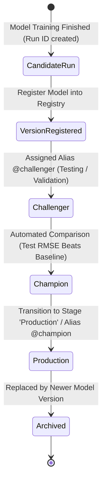

# MLflow Model Registry & Model Promotion Lifecycle

## 1. What Problem Does the Model Registry Solve?

In many teams, deployed models are managed through informal practices:
- Saving files like `model_final_v2_really_final.pkl` on shared network folders.
- Hardcoding specific S3 bucket paths into prediction microservices.
- No historical record of who approved a model or which commit/dataset produced it.

The **MLflow Model Registry** provides a centralized, database-backed catalog that manages the full lifecycle of ML models:
1. **Model Governance:** Explicit versioning (Version 1, Version 2, etc.) for each registered model.
2. **Promotion Workflows:** Moving models through stages (`Staging` -> `Production` -> `Archived`) or semantic aliases (`@champion`, `@challenger`).
3. **Decoupled Deployment:** Production applications always load `models:/house-price-predictor@champion` without changing code when a new model version is released.

---

## 2. Model Lifecycle & Promotion Architecture



---

## 3. Stages vs. Modern Aliases

MLflow previously utilized fixed **Stages** (`None`, `Staging`, `Production`, `Archived`). In modern MLflow (v2.8+ and v3.x), stages are supplemented by flexible **Model Aliases**:

- **`@champion`**: The current primary model serving live production traffic.
- **`@challenger`**: A newly trained model being evaluated against the champion.
- **`@shadow`**: A model receiving mirror production traffic for dark launches.

Our implementation supports **both** paradigms:
```python
# Modern MLflow alias
client.set_registered_model_alias(
    name="house-price-predictor",
    alias="champion",
    version=new_version
)

# Backward-compatible stage transition
client.transition_model_version_stage(
    name="house-price-predictor",
    version=new_version,
    stage="Production",
    archive_existing_versions=True
)
```

---

## 4. Code Walkthrough (`src/training/registry.py`)

1. **Connects to MLflow Tracking Server:**
   ```python
   client = MlflowClient(tracking_uri="http://mlflow:5000")
   ```
2. **Registers Model Version:**
   Points to the source run artifact URI `runs:/<run_id>/model` and registers it under the logical model name `house-price-predictor`.
3. **Promotes Model:**
   Tags the new version with `@champion` alias and sets stage to `Production`.
4. **Archives Predecessors:**
   `archive_existing_versions=True` automatically demotes any previously active version to `Archived`, ensuring only one production model is active at any time.

---

## 5. Serving from the Model Registry

The FastAPI application (`api/dependencies.py`) loads the production model directly using the registered URI:

```python
target_uri = "models:/house-price-predictor@champion"
model = mlflow.sklearn.load_model(target_uri)
```

If MLflow is unreachable during an air-gapped test or network partition, the application smoothly falls back to the locally serialized fallback pipeline at `models/full_pipeline.joblib`.

---

## 6. Real-World Commands

```bash
# List all registered models
python -c "from mlflow import MlflowClient; print([m.name for m in MlflowClient().search_registered_models()])"

# Inspect model versions and aliases
python -c "from mlflow import MlflowClient; print([(v.version, v.aliases) for v in MlflowClient().search_model_versions(\"name='house-price-predictor'\")])"
```

