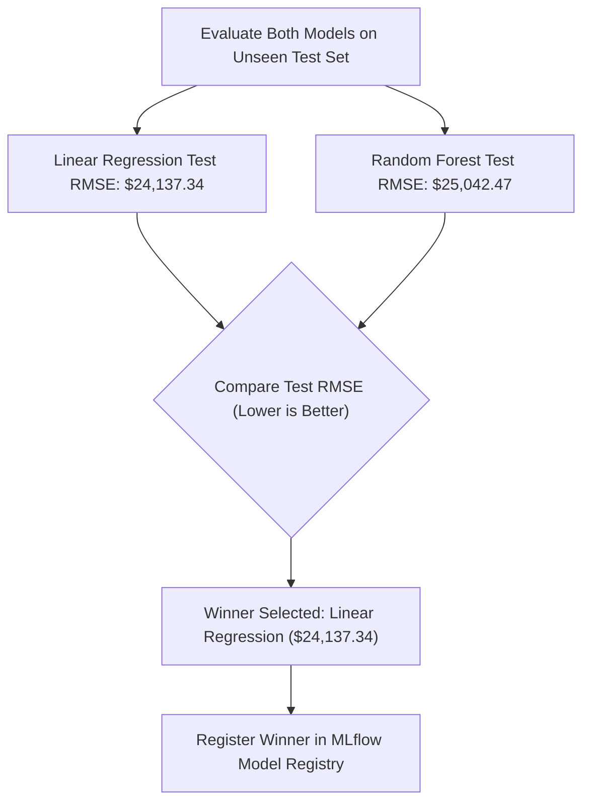

# Model Training & Evaluation Architecture

## 1. Regression Algorithms & Trade-offs

In this lab, we train and compare two distinct regression model families:

| Model | Type | Advantages | Potential Limitations |
| :--- | :--- | :--- | :--- |
| **Linear Regression** | Parametric, Linear | Fast to train, highly interpretable weights, excellent generalization when true relationships are predominantly linear. | Cannot naturally capture complex non-linear feature interactions without manual polynomial expansion. |
| **Random Forest Regressor** | Non-parametric, Ensemble Trees | Naturally handles non-linearities and feature interactions, robust to outliers, provides feature importance. | Prone to overfitting on training data if tree depth or min leaf samples are unconstrained, larger memory footprint. |

---

## 2. Evaluation Metrics Definition & Mathematical Formulations

To evaluate the predictive performance of our models on residential real estate pricing, we track four core regression metrics:

1. **Mean Absolute Error (MAE):**
   $$\text{MAE} = \frac{1}{n}\sum_{i=1}^{n} |y_i - \hat{y}_i|$$
   - **Interpretation:** The average dollar error between predicted price and actual price. Linear penalty; robust to outliers.

2. **Mean Squared Error (MSE):**
   $$\text{MSE} = \frac{1}{n}\sum_{i=1}^{n} (y_i - \hat{y}_i)^2$$
   - **Interpretation:** Penalizes large prediction errors quadratically. Useful when large blunders are heavily penalized in business applications.

3. **Root Mean Squared Error (RMSE):**
   $$\text{RMSE} = \sqrt{\text{MSE}} = \sqrt{\frac{1}{n}\sum_{i=1}^{n} (y_i - \hat{y}_i)^2}$$
   - **Interpretation:** Retains the quadratic penalty of MSE but returns the units back to standard currency (USD). Serves as our **primary selection metric**.

4. **Coefficient of Determination ($R^2$ Score):**
   $$R^2 = 1 - \frac{\sum (y_i - \hat{y}_i)^2}{\sum (y_i - \bar{y})^2}$$
   - **Interpretation:** Percentage of variance in house price explained by the model features (values close to 1.0 indicate excellent fit).

---

## 3. Preventing Data Leakage

Data leakage occurs when information from outside the training dataset is inadvertently used to create the model, leading to overly optimistic evaluation results that collapse in production.

Our architecture strictly prevents leakage through the following practices:
1. **Train/Test Split Before Preprocessing:**
   ```python
   # Split happens first
   X_train, X_test, y_train, y_test = train_test_split(X, y, test_size=0.2, random_state=42)
   ```
2. **Fit on Train Only, Transform Both:**
   The `ColumnTransformer` (median imputers and `StandardScaler` mean/variance) is fitted **strictly** on `X_train`. `X_test` is only transformed using the training statistics:
   ```python
   preprocessor.fit(X_train)
   train_transformed = preprocessor.transform(X_train)
   test_transformed = preprocessor.transform(X_test)
   ```

---

## 4. Automated Model Selection Logic

A fundamental rule in production machine learning:
> **Never select a model based on training performance alone.**

In our training run:
- **Random Forest:** Achieved Train RMSE = **\$13,576.40** ($R^2$ = 0.9917), but Test RMSE = **\$25,042.47** ($R^2$ = 0.9726). The decision trees memorized training noise.
- **Linear Regression:** Achieved Train RMSE = **\$23,259.75** ($R^2$ = 0.9755), and Test RMSE = **\$24,137.34** ($R^2$ = 0.9746).



Because Linear Regression achieved a lower Test RMSE (\$24,137 vs \$25,042), the automated selection script picks Linear Regression as the champion model.

---

## 5. Artifact Packaging (`full_pipeline.joblib`)

To make downstream serving robust, `src/training/train.py` exports an end-to-end `Pipeline`:
```python
full_pipeline = Pipeline([
    ("preprocessor", preprocessor),
    ("regressor", best_model)
])
joblib.dump(full_pipeline, "models/full_pipeline.joblib")
```
This guarantees that the FastAPI prediction service receives raw JSON features, runs the fitted imputation, one-hot encoding, and standard scaling internally, and feeds the resulting feature vector directly to the regressor without duplicate preprocessing code.

