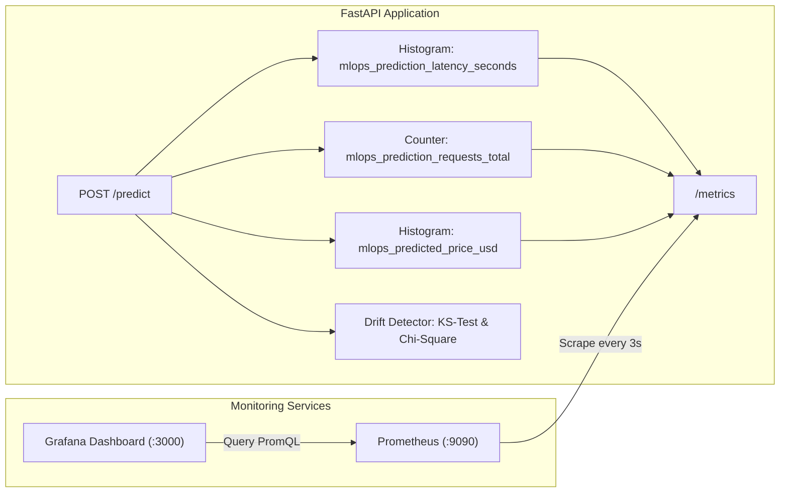

# MLOps Monitoring: Infrastructure vs. Model Quality Monitoring

## 1. What Problem Does Monitoring Solve?

Traditional software applications usually fail loudly: exceptions are thrown, stack traces are printed, and HTTP 500 error rates spike.

Machine Learning models, however, **fail silently**:
- The REST API continues returning HTTP 200 OK with fast sub-millisecond response times.
- Memory and CPU usage remain completely normal.
- **Yet the predictions are completely wrong!**

This silent degradation occurs because real-world distributions shift over time: interest rates change, inflation increases, consumer behavior evolves, or data upstream pipelines change format. Without proper monitoring, model degradation goes unnoticed until business revenue is severely damaged.

---

## 2. Infrastructure Monitoring vs. ML Model Monitoring

A critical distinction every Senior MLOps Engineer must enforce:

| Dimension | Infrastructure Monitoring (DevOps) | ML Model Monitoring (MLOps) |
| :--- | :--- | :--- |
| **Focus** | System stability, resource utilization, networking. | Statistical distribution of inputs, prediction distributions, model degradation. |
| **Key Metrics** | - CPU & Memory usage - Request throughput (req/sec) - p95 / p99 HTTP latency - HTTP 4xx / 5xx error rates - Container uptime | - **Data Drift** (Kolmogorov-Smirnov, PSI, Wasserstein distance) - **Concept Drift** (Relationship between features and target shifts) - **Prediction Drift** (Distribution of outputs over time) - Production MAE/RMSE (when ground truth labels arrive) |
| **Tools** | Prometheus, Grafana, Datadog, CloudWatch. | Prometheus (output distribution), Evidently AI, Whylogs, custom statistical tests. |
| **Failure Mode** | Container crashes, timeouts, memory leaks. | Model produces outdated or biased predictions while responding with HTTP 200 OK. |

> **Important Rule:** Never claim that API availability and latency alone represent model quality monitoring! An API with 100% uptime and 10ms latency can easily be generating 100% garbage predictions.

---

## 3. Telemetry Architecture

---

## 4. Prometheus Metrics Exported

In `api/main.py`, we expose the following Prometheus metrics:

1. **`mlops_prediction_requests_total{model_name="...", status="success|error_invalid_input|..."}`:**
   - Type: Counter
   - Monitors overall query volume, traffic spikes, and validation error counts.
2. **`mlops_prediction_latency_seconds_bucket{endpoint="..."}`:**
   - Type: Histogram (buckets: 5ms to 2.5s)
   - Tracks response latency percentiles ($p_{50}$, $p_{95}$, $p_{99}$).
3. **`mlops_predicted_price_usd_bucket`:**
   - Type: Histogram (buckets: \$100k to \$2M)
   - **ML-Specific:** Tracks the distribution of model outputs. A shift toward extreme buckets indicates potential upstream data corruption or macroeconomic drift.
4. **`mlops_invalid_requests_total{error_type="..."}`:**
   - Type: Counter
   - Tracks malformed payloads violating Pydantic schema constraints.
5. **`mlops_api_uptime_seconds`:**
   - Type: Gauge
   - Monitors service stability and tracks container restarts.

---

## 5. Statistical Data Drift Detection Engine

In `src/monitoring/drift_detector.py`, we implement automated statistical hypothesis testing comparing live inference batches against the baseline reference dataset (`data/raw/housing.csv`):

### 1. Numerical Features: Two-Sample Kolmogorov-Smirnov Test
- **Test:** `scipy.stats.ks_2samp(baseline_series, current_series)`
- **Null Hypothesis ($H_0$):** Both samples are drawn from the same continuous probability distribution.
- **Threshold:** $\alpha = 0.05$. If $p\text{-value} < 0.05$, reject $H_0 \rightarrow$ **Data Drift Detected!**

### 2. Categorical Features: Chi-Square Goodness-of-Fit Test
- **Test:** `scipy.stats.chisquare(f_obs, f_exp)`
- **Null Hypothesis ($H_0$):** Category proportions (urban, suburban, rural) follow the baseline population distribution.
- **Threshold:** If $p\text{-value} < 0.05$, reject $H_0 \rightarrow$ **Categorical Drift Detected!**

### Triggering Retraining
When data drift is confirmed across multiple batches:
1. Alerts trigger via Prometheus Alertmanager or webhook.
2. The retraining pipeline (`make pipeline`) is executed to train an updated model on the newly shifted data.
3. The new model is evaluated; if it beats the champion, it is promoted to production.

---

## 6. Pre-Provisioned Grafana Dashboard

Grafana is pre-configured with a custom dashboard (`configs/grafana/dashboards/mlops_dashboard.json`) containing:
- **Total Prediction Requests:** Gauge panel showing cumulative throughput.
- **API Uptime:** Real-time uptime tracker.
- **422 Schema Validation Errors:** Immediate alert panel for invalid inputs.
- **Latency Quantiles:** Timeseries tracking median ($p_{50}$), $p_{90}$, and $p_{99}$ latencies.
- **Output Price Distribution:** Visual histogram timeseries showing shifts in predicted price ranges.

